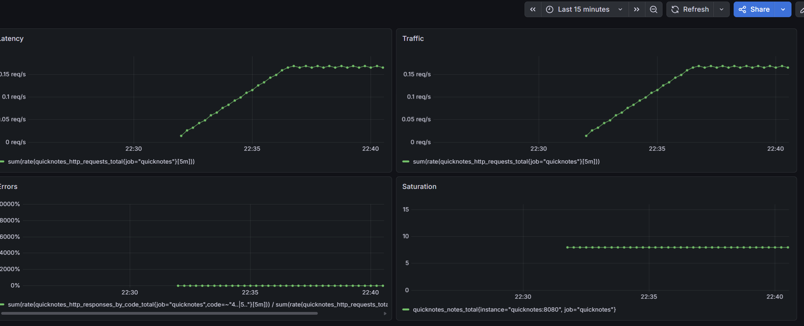
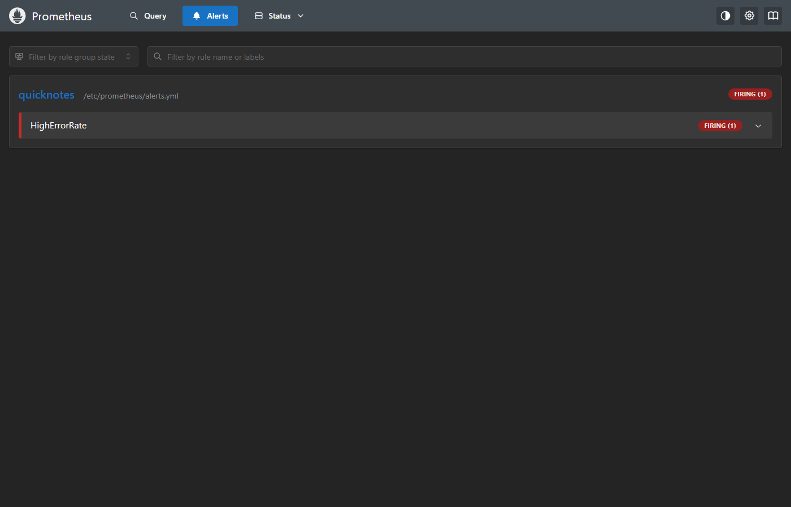

# Lab 8

## Task 1

[compose.yaml](../compose.yaml), [prometheus.yml](../monitoring/prometheus/prometheus.yml), [datasource.yml](../monitoring/grafana/provisioning/datasources/datasource.yml), [dashboard.yml](../monitoring/grafana/provisioning/dashboards/dashboard.yml), dashboard json: [golden-signals.json](../monitoring/grafana/dashboards/golden-signals.json)

```
$ curl -s http://localhost:9090/api/v1/targets | jq '.data.activeTargets[].health'
"up"
```



a) Prometheus pulls, so it has to reach QuickNotes. If it can't, there will be no new samples. old points on the graph don't mean the app is alive

b) 5s = more samples and load, 5m = too sparse for a 5m rate window, spikes disappear -- you can miss short calls. 15s is fine here

c) I use rate() for traffic - it shows rps and handles counter resets. irate() is too jumpy for this panel; delta() is for gauges, not counters

d) The stack comes up with the same datasource and dashboard every time, and changes are in git

## Task 2

Rule ([alerts.yml](../monitoring/prometheus/alerts.yml)):
```yaml
- alert: HighErrorRate
  expr: sum(rate(quicknotes_http_responses_by_code_total{job="quicknotes",code=~"4..|5.."}[5m])) / sum(rate(quicknotes_http_requests_total{job="quicknotes"}[5m])) > 0.05
  for: 5m
  labels:
    severity: page
```

The alert fired with 4 good requests + 1 bad json body per loop. done like this

```bash
for i in {1..660}; do
  for j in {1..4}; do
    curl -s -o /dev/null http://localhost:8080/notes
  done
  curl -s -o /dev/null -H 'Content-Type: application/json' \
    -d '{' http://localhost:8080/notes
  sleep 1
done
```



Runbook: [docs/runbook/high-error-rate.md](../docs/runbook/high-error-rate.md)

promtool check config and promtool test rules ([alerts.test.yml](../monitoring/prometheus/alerts.test.yml)) both ok

e) The 5 min wait filters out short spikes. If the ratio stays high, it is worth checking, but it can still be one client sending bad JSON, like in this test

f) High CPU alone doesnt tell me if users have a problem. Requests can still work with busy CPU, while a wrong config can cause errors with idle CPU. I would page on the failed requests and use CPU to investigate

g) I would start with 10%: if more than 1 in 10 pages has no user impact, review the rule. I would also count missed incidents before raising the threshold
