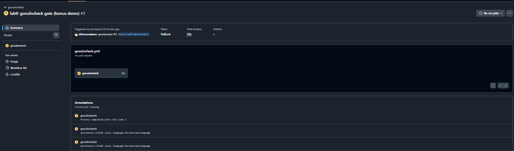
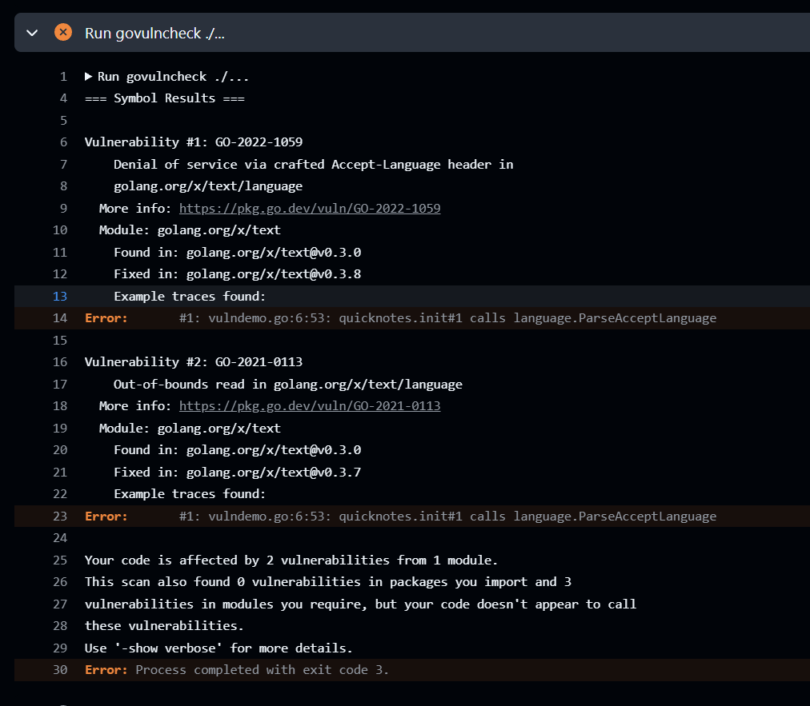
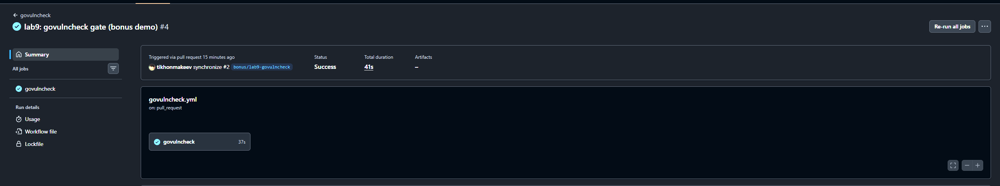

# Lab 9

Trivy 0.67.2, ZAP 2.17.0. SBOM and ZAP reports in [submissions](.).
Dockerfile is unchanged from Lab 6: golang:1.24-alpine based
## Task 1

```
trivy image --severity HIGH,CRITICAL quicknotes:lab6
2026-10-18T02:26:11+03:00       INFO    [vuln] Vulnerability scanning is enabled
2026-10-18T02:26:11+03:00       INFO    [secret] Secret scanning is enabled
2026-10-18T02:26:11+03:00       INFO    [secret] If your scanning is slow, please try '--scanners vuln' to disable secret scanning
2026-10-18T02:26:11+03:00       INFO    [secret] Please see https://trivy.dev/docs/v0.76/guide/scanner/secret#recommendation for faster secret detection
2026-10-18T02:26:11+03:00       INFO    Detected OS     family="debian" version="13.7"
2026-10-18T02:26:11+03:00       INFO    [debian] Detecting vulnerabilities...   os_version="13" pkg_num=6
2026-10-18T02:26:11+03:00       INFO    Number of language-specific files       num=1
2026-10-18T02:26:11+03:00       INFO    [gobinary] Detecting vulnerabilities...
2026-10-18T02:26:11+03:00       WARN    Using severities from other vendors for some vulnerabilities. Read https://trivy.dev/docs/v0.76/guide/scanner/vulnerability#severity-selection for details.

Report Summary

┌───────────────────────────────┬──────────┬─────────────────┬─────────┐
│            Target             │   Type   │ Vulnerabilities │ Secrets │
├───────────────────────────────┼──────────┼─────────────────┼─────────┤
│ quicknotes:lab6 (debian 13.7) │  debian  │        0        │    -    │
├───────────────────────────────┼──────────┼─────────────────┼─────────┤
│ quicknotes                    │ gobinary │       22        │    -    │
└───────────────────────────────┴──────────┴─────────────────┴─────────┘
```
```
trivy fs --severity HIGH,CRITICAL .
2026-10-18T02:31:25+03:00       INFO    [vuln] Vulnerability scanning is enabled
2026-10-18T02:31:25+03:00       INFO    [secret] Secret scanning is enabled
2026-10-18T02:31:25+03:00       INFO    [secret] If your scanning is slow, please try '--scanners vuln' to disable secret scanning
2026-10-18T02:31:25+03:00       INFO    [secret] Please see https://trivy.dev/docs/v0.76/guide/scanner/secret#recommendation for faster secret detection
2026-10-18T02:31:25+03:00       INFO    Number of language-specific files       num=1
2026-10-18T02:31:25+03:00       INFO    [gomod] Detecting vulnerabilities...

Report Summary

┌────────────┬───────┬─────────────────┬─────────┐
│   Target   │ Type  │ Vulnerabilities │ Secrets │
├────────────┼───────┼─────────────────┼─────────┤
│ app/go.mod │ gomod │        0        │    -    │
└────────────┴───────┴─────────────────┴─────────┘
```

```
trivy config .
2026-10-18T02:32:12+03:00       INFO    [misconfig] Misconfiguration scanning is enabled
2026-10-18T02:32:12+03:00       INFO    [checks-client] Need to update the checks bundle
2026-10-18T02:32:12+03:00       INFO    [checks-client] Downloading the checks bundle...
234.57 KiB / 234.57 KiB [---------------------------------------------------------------------------------------------------------------------------------------------------------------------------------------------------------------------------] 100.00% 2.81 MiB p/s 300ms
2026-10-18T02:32:14+03:00       INFO    Detected config files   num=1

Report Summary

┌────────────────┬────────────┬───────────────────┐
│     Target     │    Type    │ Misconfigurations │
├────────────────┼────────────┼───────────────────┤
│ app/Dockerfile │ dockerfile │         1         │
└────────────────┴────────────┴───────────────────┘
```

The config has LOW issue: no HEALTHCHECK in the Dockerfile. I kept the Dockerfile from Lab 6 and put the healthcheck in compose.yaml. This covers containers started through Compose


SBOM ([sbom.cdx.json](sbom.cdx.json)), first 30 lines:
```json
{
  "$schema": "http://cyclonedx.org/schema/bom-1.6.schema.json",
  "bomFormat": "CycloneDX",
  "specVersion": "1.6",
  "serialNumber": "urn:uuid:87cc6587-e1e0-4a10-af6e-4426fc56c8a7",
  "version": 1,
  "metadata": {
    "timestamp": "2026-10-13T22:20:57+00:00",
    "tools": {
      "components": [
        {
          "type": "application",
          "manufacturer": {
            "name": "Aqua Security Software Ltd."
          },
          "group": "aquasecurity",
          "name": "trivy",
          "version": "0.67.2"
        }
      ]
    },
    "component": {
      "bom-ref": "pkg:oci/quicknotes@sha256%3Ae56d9f060e9e0d61b63db454179230259ec74d8e90098d6c539558d84fee5080?arch=amd64&repository_url=index.docker.io%2Flibrary%2Fquicknotes",
      "type": "container",
      "name": "quicknotes:lab6",
      "purl": "pkg:oci/quicknotes@sha256%3Ae56d9f060e9e0d61b63db454179230259ec74d8e90098d6c539558d84fee5080?arch=amd64&repository_url=index.docker.io%2Flibrary%2Fquicknotes",
      "properties": [
        {
          "name": "aquasecurity:trivy:DiffID",
          "value": "sha256:187cfc6d1e3e8a40a5e64653bcd3239c140807dcf1c09e48021178705a5a6139"
```

All 22 HIGH findings below are in the Go 1.24.13 standard library. I temporarily ACCEPT them for local lab testing, keeping the Dockerfile from Lab 6. They are still unresolved: I need to update Go and rebuild before using this image outside the lab. Will review on 30.11.2026
| CVE | Decision |
|---|---|
| CVE-2026-25679 | ACCEPT |
| CVE-2026-27145 | ACCEPT |
| CVE-2026-32280 | ACCEPT |
| CVE-2026-32281 | ACCEPT |
| CVE-2026-32283 | ACCEPT |
| CVE-2026-33811 | ACCEPT |
| CVE-2026-33814 | ACCEPT |
| CVE-2026-33818 | ACCEPT |
| CVE-2026-39820 | ACCEPT |
| CVE-2026-39821 | ACCEPT |
| CVE-2026-39822 | ACCEPT |
| CVE-2026-39836 | ACCEPT |
| CVE-2026-42499 | ACCEPT |
| CVE-2026-42504 | ACCEPT |
| CVE-2026-56853 | ACCEPT |
| CVE-2026-56858 | ACCEPT |
| CVE-2026-56859 | ACCEPT |
| CVE-2026-56860 | ACCEPT |
| CVE-2026-56862 | ACCEPT |
| CVE-2026-78667 | ACCEPT |
| CVE-2026-78669 | ACCEPT |
| CVE-2026-97031 | ACCEPT |


a) I would also check is my app really using affected function

b) A smaller base has fewer packages that can need fixes

c) I would suppress a finding only after checking why it doesnt apply, and write down the reason and when to review it

d) An SBOM lets me search for an affected package and version without rebuilding or unpacking every image. Then I still need to check whether the vulnerability applies to how that image is used

## Task 2

Reports: [before](zap-before/report.html), [after](zap-after/report.html).

|id|finding|risk|url|decision|
|---|---|---|---|---|
|10021|missing x-content-type-options|low|/notes|fix: nosniff|
|10049|cacheable content|info|/notes, /robots.txt|fix: cache-control: no-store|
|90004|missing/invalid CORP header|low|/notes|fix: CORP: same-origin|
|10049|non-storable content (after)|info|/notes, /sitemap.xml|accept: notes shouldnt be cached, will review at 30.11.2026|

Fix middleware Routes returns securityHeaders so all responses get headers
```
before: WARN-NEW: 3   PASS: 64
  X-Content-Type-Options Header Missing [10021]
  Storable and Cacheable Content [10049]
  Cross-Origin-Resource-Policy Header Missing or Invalid [90004]

after:  WARN-NEW: 1   PASS: 66
  Non-Storable Content [10049]
```

10049 after the fix reports that the response is not cached, which is what I want for notes. The two missing-header findings are fixed

e) One place for all routes, also future ones. Per handler its easy to forget in a new endpoint

f) default-src 'none' blocks resource loads such as scripts and images unless another directive allows them. It would break UI that needs those resources. QuickNotes serves JSON, so I dont need to allow them here

g) Real findings get lost in the noise and "accepted" becomes permanent without a reason or date

## Bonus

[.github/workflows/govulncheck.yml](../.github/workflows/govulncheck.yml), separate job, govulncheck@v1.9.0

added bad dependency `golang.org/x/text v0.3.0`and call `language.ParseAcceptLanguage`







h) govulncheck checks the call graph, so it reports only what my code can reach, not everything in go.mod. Less noise

i) With @latest the check can change without any commit from me and CI goes red or green for no reason

j) OS packages in the image, the base image, Dockerfile/compose misconfig, secrets. Only Go code
